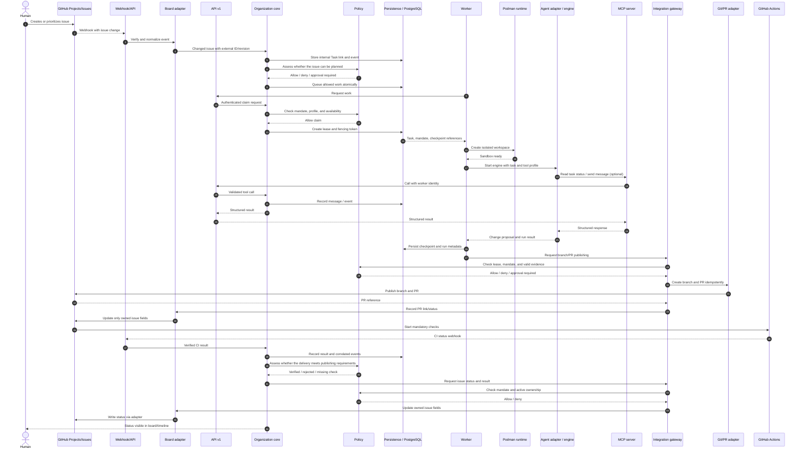
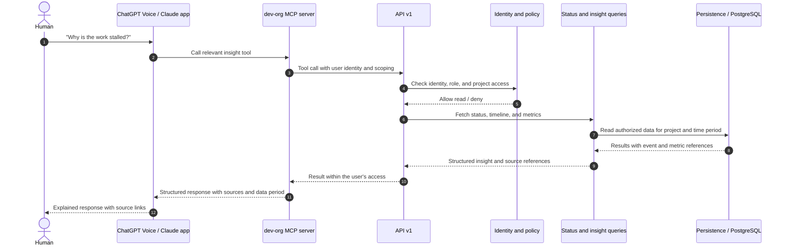
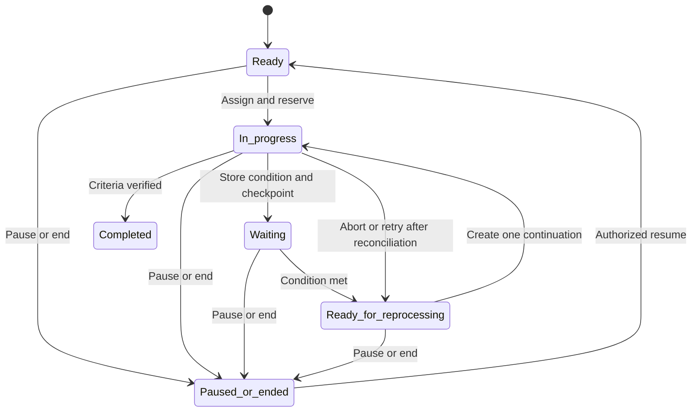
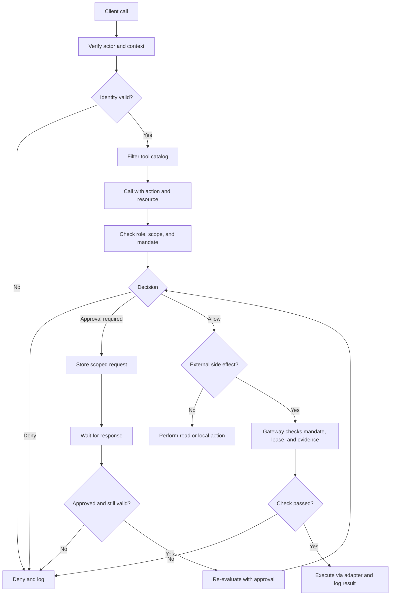
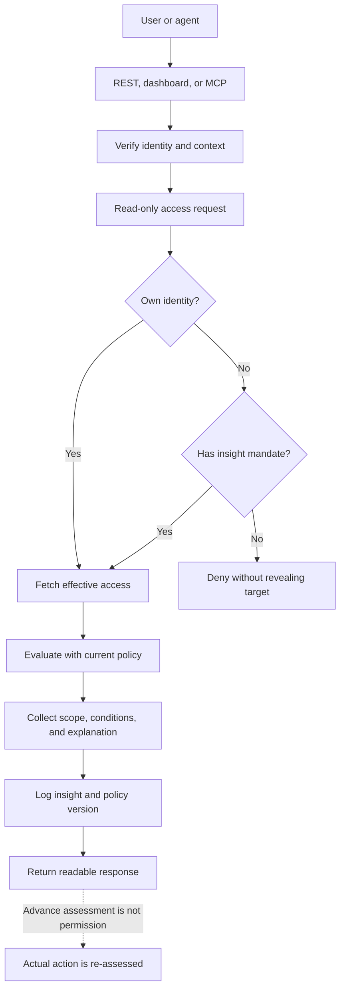
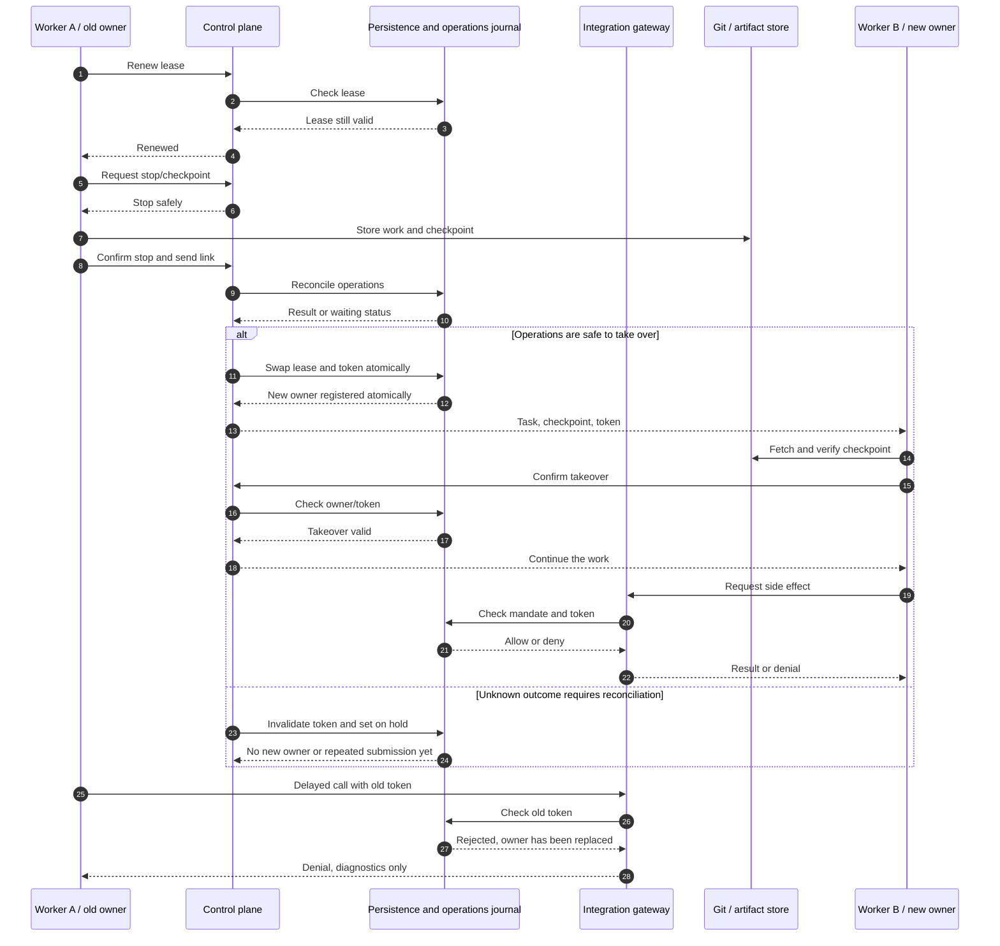
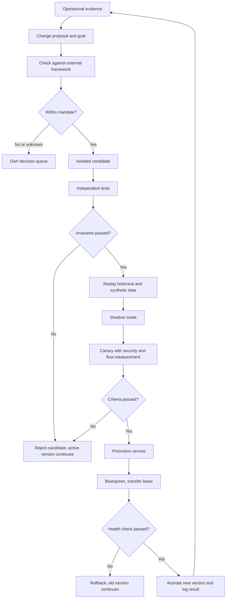

# System diagrams

These diagrams show the MVP architecture described in [the system specification](../../dev-org-specification.md). They are architectural views, not a replacement for the module contracts or the operational configuration. Update the diagrams together with the spec when responsibilities or data flows change.

## Components and responsibilities

[Editable PlantUML source](system-overview.puml)

The overview shows the ports as small squares on the boundary of the control service. Inbound ports receive REST, MCP, worker, and webhook traffic. Outbound ports connect the core to storage, board, Git/PR, CI, execution environment, and artifacts. The diagram shows responsibilities and runtime data flow; modules in the control service need not be separate processes.

**Important boundaries:**

- The dashboard and voice/chat client are parallel entry points. The voice app connects directly to MCP; it does not go through the dashboard.
- MCP is one protocol entry with a tool registry and profiles. The groups are modules, not separate server processes. Identity and policy govern each call. Access insight is a read-only module over the same identity and policy decisions; the advance assessment does not perform the action.
- The worker fetches tasks via the Worker API. The agent engine runs isolated and does not receive the control service's secrets. External side effects are enforced by the gateway.
- Local board adapter and A2A are optional or later extensions. GitHub and PostgreSQL are the chosen MVP adapters.

## Ports and adapters

The table concretizes the ports already shown on the control service boundary in the main diagram. The ports are module contracts, not extra network hops. Arrows in the UML image show runtime data flow; the adapters depend on the contracts in code, while the core does not import adapter implementations.

| Direction | Port | MVP adapter(s) | Use |
|---|---|---|---|
| Inbound | REST / API | REST adapter | Dashboard and API clients call use cases through identity and policy. |
| Inbound | MCP | MCP adapter with insight, access, work, message, and optional administration groups | Voice and agent clients only see tools that are qualified and permitted for the identity. The access group reads effective rights and assesses actions without performing them. Every call goes through the same authorization. |
| Inbound | Worker API | Worker adapter | Workers fetch tasks, renew the lease, and deliver checkpoints with their own worker identity. |
| Inbound | Webhook | GitHub webhook adapter | Verified issue and CI events are normalized before they affect internal state. |
| Inbound · later | A2A | External agent adapter | External agent identities must be linked to a trust profile before responses can affect work. |
| Outbound | Persistence | PostgreSQL adapter | Internal task, lease, policy, message, and event state is stored transactionally. |
| Outbound | WorkTracking | GitHub Projects/Issues; local file adapter for development and local workflows | Fetches and updates the backlog via one active board adapter per project. |
| Outbound | Git / PR | GitHub Git/PR adapter | Publishes branch and PR idempotently through the gateway. |
| Outbound | CI status | GitHub Actions adapter | Reads check runs and reconciles webhook results. |
| Outbound | ExecutionBackend | Rootless Podman adapter | Creates and ends an isolated workspace and agent process. |
| Outbound | Artefakter | Artifact adapter | Secures checkpoints, logs, and delivery artifacts with integrity references. |

## Sequence: GitHub issue to verified PR

## Sequence: a human asks a voice app for insight

## Task life cycle

The diagram shows the authoritative operational states of a task as defined in part 5 of the specification. A wait condition can for example be a user response, an approval, a resource, or an external result. Resume creates at most one continuation for the same event and state.

**Interpretation:** `In progress` means that one attempt has one active owner with a time-limited reservation and fencing token. The attempt and the reservation have their own life cycles; an expired lease is not a new task state. Before a new attempt or a continuation is started, uncertain external operations are reconciled and the old owner must be stopped or cut off from writing. The engine's conversation ID does not change the task state.

## Authorization flow

The tool profile determines what the client can discover, but does not by itself grant permission. Every call is assessed with verified identity and the concrete action and resource. An approval applies only to the original, unchanged basis.

## Access insight

Access insight is a read-only use case over identity and policy. One's own access can be inspected by the actor; insight into others requires special mandate. An advance assessment shows what the policy answers now, but does not grant permission for a later execution.

The response can show action classes, resource scope, conditions, rationale, policy version, and evaluation time. It never shows credentials or secrets. Insight into other identities cannot be used to bypass project scoping.

## Lease and handover between nodes

The sequence shows controlled movement between workers. The same fencing check applies when a lease expires or an old node returns after a network failure.

## Self-improvement loop

The candidate runs with separate state and low-priority, interruptible capacity. Only an independent promotion service can activate changes within the standing framework; ordinary work continues under the active version.

## Diagram scope and remaining contracts

The diagrams show selected normal flows. Retry, expired lease, duplicate webhooks, CI reconciliation, and unresolved external calls follow the normative rules in parts 3.2 and 5–7 of [the specification](../../dev-org-specification.md); they should not be copied in here as parallel rules.

The architecture decision for external mutations is closed: the organization core owns the use case and asks the gateway to perform the change; only the gateway calls mutating adapter operations. The GitHub issue sequence shows this flow.

The following versioned contract artifacts must be finalized before the corresponding adapter is implemented. The spec fixes the semantics; the routes, serialized schemas, and adapter-specific configuration values belong in these contracts.

| Contract artifact | Already fixed | To concretize before |
|---|---|---|
| Worker API | Claim, lease/fencing, checkpoint, result, stop, and handover rules in parts 5 and 7. | Worker adapter: operations, payloads, errors, authentication, idempotency, and retry response. |
| `Task`, `Attempt` and `Reservation` | Task, attempt, and reservation are separate concepts; life cycle and ownership rules are described in part 5. | Persistence and worker adapter: versioned fields, IDs, relations, and migration rules. They must not be merged into one state machine. |
| Checkpoint and artifact reference | Required checkpoint content, integrity check, and move principles in parts 5 and 7. | Artifact/worker adapter: reference schema, upload/download, retention, and error handling. |
| MCP tool catalog | Versioned groups, access rules, and use cases are described in parts 3.2 and 4. | MCP adapter: exact tool names, input/output schema, errors, and pagination where needed. |
| Board status mapping | Common statuses are `Ready`, `In progress`, `Blocked`, `In review`, and `Done`; unknown status automatically stops assignment. | Project setup/board adapter: concrete GitHub field IDs and alternate IDs, validated against the chosen project before activation. |

Availability of custom MCP servers in a particular voice app is a client/vendor limitation, not an open architecture decision. It is discussed in part 4; other compatible MCP clients use the same entry point.