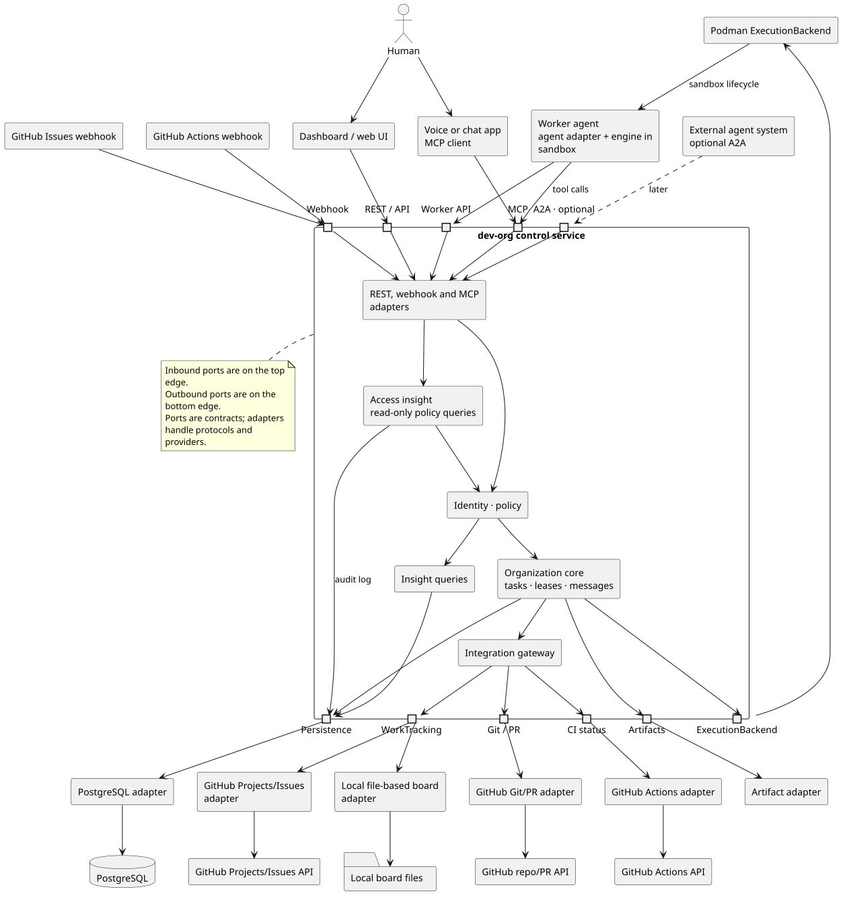
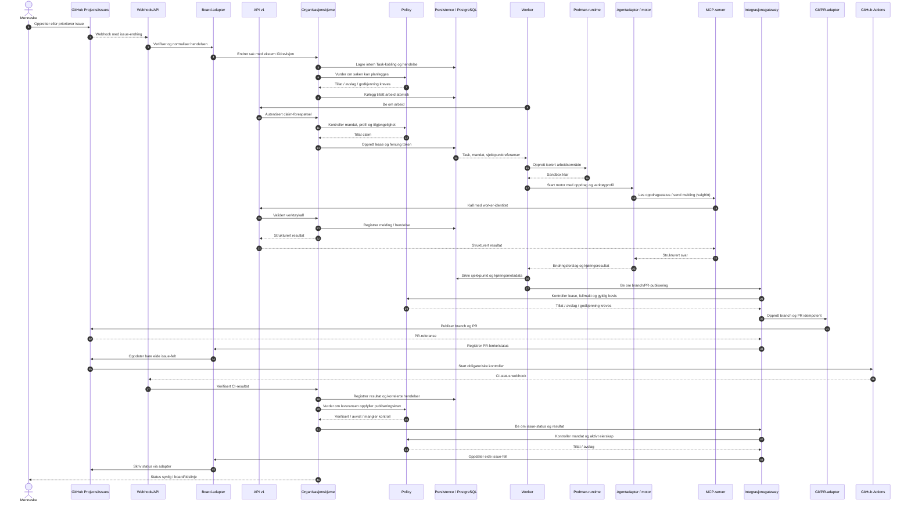
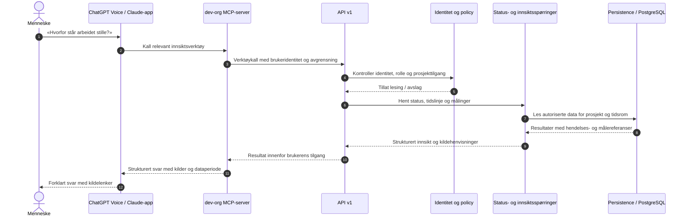
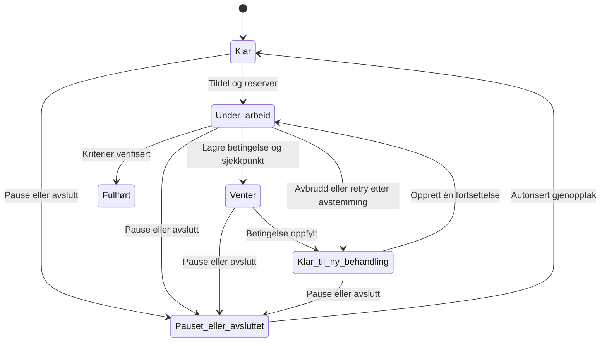
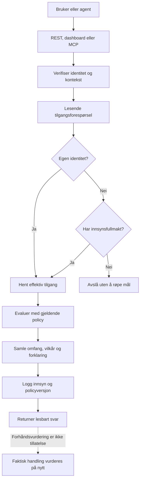
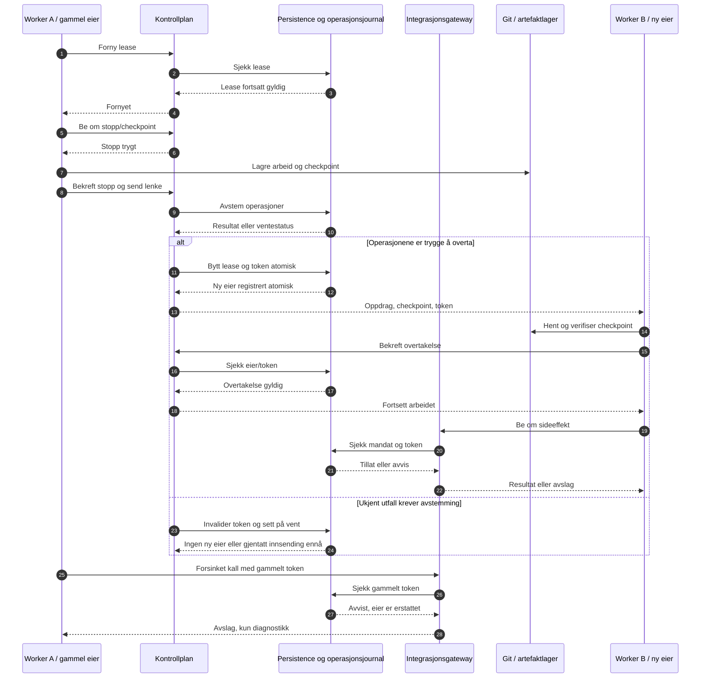
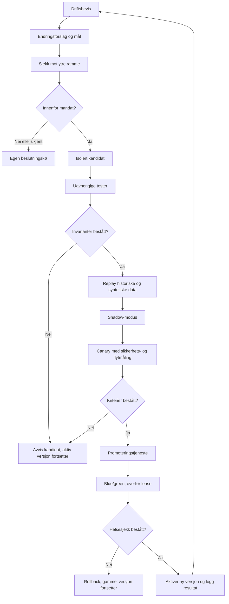

# Systemdiagrammer

Disse diagrammene viser MVP-arkitekturen beskrevet i [systemspesifikasjonen](../../dev-org-spesifikasjon.md). De er arkitekturvisninger, ikke en erstatning for modulkontraktene eller den operative konfigurasjonen. Oppdater diagrammene sammen med spekken når ansvar eller dataflyt endres.

[Åpne den interaktive arkitektureksploreren](explorer.html) for å navigere fra systemoversikten til moduler og flyter. Eksploreren er en lett, statisk HTML-side med relative lenker, slik at den også kan publiseres under en GitHub Pages-prosjektsti.

## Komponenter og ansvar

[Redigerbar PlantUML-kilde](system-overview.puml)

Oversikten viser portene som små kvadrater på randen av kontrolltjenesten. Inngående porter mottar REST-, MCP-, worker- og webhook-trafikk. Utgående porter kobler kjernen til lagring, board, Git/PR, CI, kjøremiljø og artefakter. Diagrammet viser ansvar og kjøredataflyt; moduler i kontrolltjenesten trenger ikke være egne prosesser.

**Viktige grenser:**

- Dashboard og stemme-/chatklient er parallelle innganger. Stemmeappen kobler direkte til MCP; den går ikke gjennom dashboardet.
- MCP er én protokollinngang med verktøyregister og profiler. Gruppene er moduler, ikke egne serverprosesser. Identitet og policy kontrollerer hvert kall. Rettighetsinnsyn er en lesende modul over de samme identitets- og policybeslutningene; forhåndsvurdering utfører ikke handlingen.
- Arbeideren henter oppdrag via Worker API. Agentmotoren kjører isolert og får ikke kontrolltjenestens hemmeligheter. Eksterne sideeffekter håndheves av gatewayen.
- Lokal boardadapter og A2A er valgfrie eller senere utvidelser. GitHub og PostgreSQL er de valgte MVP-adapterne.

## Porter og adaptere

Tabellen konkretiserer portene som allerede vises på kontrolltjenestens rand i hoveddiagrammet. Portene er modulkontrakter, ikke ekstra nettverkshopp. Piler i UML-bildet viser kjøredataflyt; adapterne avhenger av kontraktene i kode, mens kjernen ikke importerer adapterimplementasjoner.

| Retning | Port | MVP-adapter(e) | Bruk |
|---|---|---|---|
| Inngående | REST / API | REST-adapter | Dashboard og API-klienter kaller brukstilfeller gjennom identitet og policy. |
| Inngående | MCP | MCP-adapter med innsikt-, tilgangs-, arbeid-, meldings- og valgfri administrasjonsgruppe | Stemme- og agentklienter ser bare verktøy som er kvalifisert og tillatt for identiteten. Tilgangsgruppen leser effektive rettigheter og vurderer handlinger uten å utføre dem. Hvert kall går gjennom samme autorisasjon. |
| Inngående | Worker API | Worker-adapter | Arbeidere henter oppgaver, fornyer lease og leverer sjekkpunkt med egen worker-identitet. |
| Inngående | Webhook | GitHub-webhookadapter | Verifiserte issue- og CI-hendelser normaliseres før de påvirker intern tilstand. |
| Inngående · senere | A2A | Ekstern agentadapter | Eksterne agentidentiteter må kobles til en tillitsprofil før svar kan påvirke arbeid. |
| Utgående | Persistence | PostgreSQL-adapter | Intern oppdrags-, lease-, policy-, meldings- og hendelsestilstand lagres transaksjonelt. |
| Utgående | WorkTracking | GitHub Projects/Issues; lokal filadapter for utvikling og lokale arbeidsflyter | Henter og oppdaterer backlog via én aktiv boardadapter per prosjekt. |
| Utgående | Git / PR | GitHub Git/PR-adapter | Publiserer branch og PR idempotent gjennom gatewayen. |
| Utgående | CI status | GitHub Actions-adapter | Leser check runs og avstemmer webhook-resultater. |
| Utgående | ExecutionBackend | Rootless Podman-adapter | Oppretter og avslutter isolert arbeidsområde og agentprosess. |
| Utgående | Artefakter | Artefaktadapter | Sikrer sjekkpunkt, logger og leveranseartefakter med integritetsreferanser. |

## Sekvens: GitHub-sak til verifisert PR

## Sekvens: mennesket spør en stemmeapp om innsikt

## Oppdragets livssyklus

Diagrammet viser de autoritative driftstilstandene for et oppdrag slik de er definert i del 5 av spesifikasjonen. En ventebetingelse kan for eksempel være et brukersvar, en godkjenning, en ressurs eller et eksternt resultat. Gjenopptak oppretter høyst én fortsettelse for samme hendelse og tilstand.

**Tolkning:** `Under arbeid` betyr at ett forsøk har én aktiv eier med tidsbegrenset reservasjon og fencing-token. Forsøket og reservasjonen har egne livssykluser; utløpt lease er ikke en ny oppdragstilstand. Før et nytt forsøk eller en fortsettelse startes, avstemmes usikre eksterne operasjoner og gammel eier må være stanset eller avskåret fra å skrive. Motorens samtale-ID endrer ikke oppdragstilstanden.

## Autorisasjonsflyt

Verktøyprofilen bestemmer hva klienten kan oppdage, men gir ikke i seg selv tillatelse. Hvert kall vurderes med verifisert identitet og den konkrete handlingen og ressursen. En godkjenning gjelder bare det opprinnelige, uendrede grunnlaget.

## Rettighetsinnsyn

Rettighetsinnsyn er en lesende brukssak over identitet og policy. Egen tilgang kan inspiseres av aktøren; innsyn i andre krever særskilt fullmakt. En forhåndsvurdering viser hva policyen svarer nå, men gir ikke tillatelse til en senere utførelse.

Svaret kan vise handlingsklasser, ressursomfang, vilkår, begrunnelse, policyversjon og evalueringstid. Det viser aldri legitimasjoner eller hemmeligheter. Innsyn i andre identiteter kan ikke brukes til å omgå prosjektavgrensning.

## Lease og overlevering mellom noder

Sekvensen viser kontrollert flytting mellom workers. Den samme fencing-kontrollen gjelder når en lease utløper eller en gammel node kommer tilbake etter nettverksbrudd.

## Selvforbedringssløyfen

Kandidaten kjører med separat tilstand og lavprioritert, avbrytbar kapasitet. Bare en uavhengig promoteringstjeneste kan aktivere endringer innenfor den stående rammen; ordinært arbeid fortsetter under aktiv versjon.

## Diagramomfang og kontrakter som gjenstår

Diagrammene viser utvalgte normalflyter. Retry, utløpt lease, dupliserte webhooker, CI-avstemming og uavklarte eksterne kall følger de normative reglene i del 3.2 og 5–7 av [spesifikasjonen](../../dev-org-spesifikasjon.md); de skal ikke kopieres inn som parallelle regler her.

Arkitekturbeslutningen for eksterne mutasjoner er lukket: organisasjonskjernen eier brukstilfellet og ber gatewayen utføre endringen; bare gatewayen kaller muterende adapteroperasjoner. Sekvensen for GitHub-sak viser denne flyten.

Følgende versjonerte kontraktartefakter skal ferdigstilles før den tilsvarende adapteren implementeres. Spekken fastsetter semantikken; rutene, serialiserte skjemaene og adapterspesifikke konfigurasjonsverdiene hører hjemme i disse kontraktene.

| Kontraktartefakt | Allerede fastsatt | Må konkretiseres før |
|---|---|---|
| Worker API | Claim, lease/fencing, sjekkpunkt, resultat, stopp og overleveringsregler i del 5 og 7. | Worker-adapteren: operasjoner, payloads, feil, autentisering, idempotens og retry-respons. |
| `Task`, `Attempt` og `Reservation` | Oppdrag, forsøk og reservasjon er separate konsepter; livssyklus og eierskapsregler er beskrevet i del 5. | Persistence- og worker-adapter: versjonerte felt, ID-er, relasjoner og migreringsregler. De må ikke slås sammen til én statusmaskin. |
| Sjekkpunkt og artefaktreferanse | Påkrevd sjekkpunktinnhold, integritetskontroll og flytteprinsipper i del 5 og 7. | Artefakt-/worker-adapter: referanseskjema, opplasting/nedlasting, retention og feilhåndtering. |
| MCP-verktøykatalog | Versjonerte grupper, tilgangsregler og brukstilfeller er beskrevet i del 3.2 og 4. | MCP-adapter: eksakte verktøynavn, input/output-skjema, feil og paginering der det trengs. |
| Boardstatusmapping | Felles statuser er `Ready`, `In progress`, `Blocked`, `In review` og `Done`; ukjent status stanser automatisk tildeling. | Prosjektoppsett/boardadapter: konkrete GitHub-felt-ID-er og alternativ-ID-er, validert mot valgt prosjekt før aktivering. |

Tilgjengelighet for egendefinerte MCP-servere i en bestemt stemmeapp er en klient-/leverandørbegrensning, ikke en åpen arkitekturbeslutning. Den er omtalt i del 4; andre kompatible MCP-klienter bruker samme inngang.
